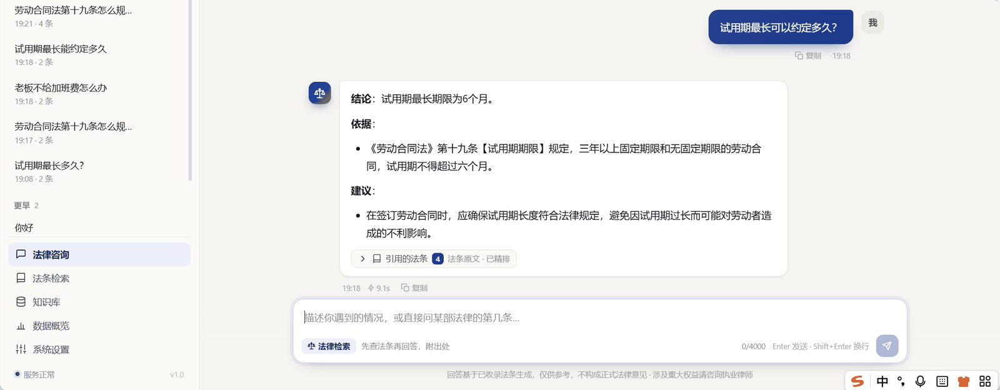
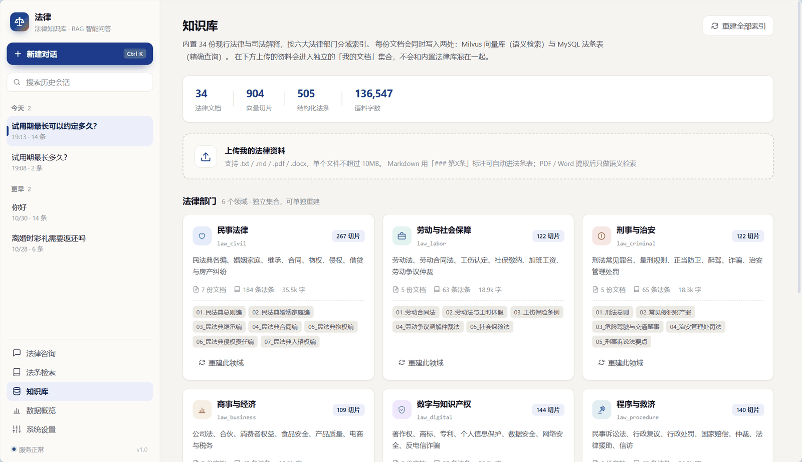
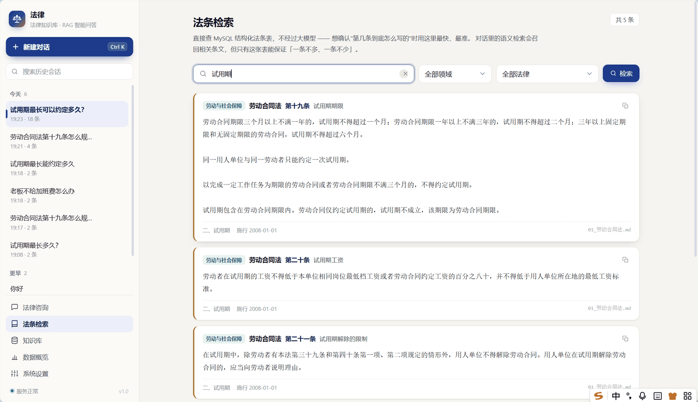

# 法眼 · 法律知识库智能问答系统

面向中国现行法律的法条检索增强（RAG）问答系统。内置 34 份法律知识文档、505 条结构化法条，
回答时先判断问题属于哪个法律部门，检索对应法条原文，再依据条文生成带出处的答案。

> 前端 Vue3 + axios ｜ 后端 **FastAPI** ｜ 向量库 Milvus Lite ｜ 结构化库 MySQL ｜ 大模型 智谱 GLM
> 文档解析 LlamaIndex（仅 reader，检索链路自研）
>
> 接口文档：启动后访问 http://127.0.0.1:5000/docs （FastAPI 自动生成，可直接调用）

---



## 这个项目解决什么问题

通用大模型回答法律问题有两个硬伤：

1. **会编法条**。问它"劳动合同法第十九条怎么规定"，它可能给你一条听起来很像、
   但条号或内容错误的规定。法律场景下这种错误代价极高。
2. **答不出处**。用户无法核实结论来自哪部法、第几条，也就无法判断是否适用于自己的情况。

本项目的做法是把"事实来源"从模型参数里剥离出来：

- **法条原文**存在两个地方：Milvus 向量库（语义检索）+ MySQL 法条表（精确查询）；
- 模型只负责**理解问题、组织语言**，不允许脱离检索结果编造条文；
- 每条回答都标注引用了哪些法条，前端可展开查看原文。

---

## 功能一览

| 模块 | 能力 |
|---|---|
| 法律咨询 | 流式问答，SSE 推送"路由 → 检索 → 生成"全过程；答案附法条出处与相关度 |
| 意图路由 | 自动判断「法条查询 / 法律咨询 / 日常闲聊」，锁定 6 大法律部门之一 |
| 混合检索 | 结构化直查（法名+条号）+ 向量语义召回 + 领域词表扩展，三路合并后 Rerank 精排 |
| 法条检索 | 独立页面，直接查 MySQL 法条表，支持关键词 / 法律 / 领域筛选与分页 |
| 知识库管理 | 六大领域独立集合，支持单领域重建、全量增量重建、上传自定义资料 |
| 会话记忆 | 会话与消息落 MySQL，重启、换浏览器都能续上；历史消息也保留法条出处 |
| 模型设置 | 运行时切换模型 / 温度 / 召回条数 / 精排开关，密钥脱敏回显，支持连通性测试 |
| 数据概览 | 会话量、消息量、7 日趋势、各领域语料规模、MySQL 与 Milvus 健康状态 |
| **MCP 服务** | 把知识库暴露给 Claude Desktop / Cursor，三个工具：语义检索、精确查条、法律清单 |
| **检索评测** | 50 条标注集，Recall@4 与 MRR，四组配置的消融实验 |

---



## 快速开始

### 0. 环境要求

- Python **3.10+**（开发环境为 3.10.8）
- Node.js **20+**（开发环境为 22）
- MySQL **8.0+**，本地运行，记住 root 密码

### 1. 后端

```bash
cd backend

# 安装依赖
python -m pip install -r requirements.txt

# 配置（把 LLM_API_KEY 换成你自己的智谱 Key，MySQL 密码按实际情况改）
copy .env.example .env      # Windows
# cp .env.example .env      # macOS / Linux

# 环境体检（会逐项检查 .env / Key / MySQL / Milvus / 知识文件）
python init_knowledge.py --check

# 建库建表 + 构建全部向量索引（首次约 8-12 分钟，走 embedding 接口，有费用）
python init_knowledge.py --build

# 启动服务
python main.py
```

后端跑在 `http://127.0.0.1:5000`：

- 接口文档（Swagger）：`http://127.0.0.1:5000/docs` ← 可以直接在页面上调接口
- 健康检查：`GET /api/health`

### 2. 前端

```bash
cd frontend
npm install
npm run dev
```

打开 `http://localhost:5173`。

> Vite 已配置代理：`/api` → `http://127.0.0.1:5000`，所以前端不需要处理 CORS。
> 后端已开启 CORS 白名单（5173 / 4173），直连也能用。

---

## 目录结构

```
legal-rag-agent/
├── backend/                        # FastAPI 后端
│   ├── main.py                     # 应用入口（lifespan + CORS + 启动）
│   ├── config.py                   # 全局配置 + 法律领域注册表
│   ├── init_knowledge.py           # 一键初始化 / 体检 / 重置
│   ├── mcp_server.py               # MCP 服务（可选，暴露给 Claude Desktop / Cursor）
│   ├── test_mcp.py                 # MCP 自检脚本（模拟客户端，验证协议链路）
│   ├── requirements.txt
│   ├── .env.example
│   │
│   ├── api/                        # ① 接口层（APIRouter）
│   │   ├── __init__.py             #    路由注册 + 全局异常处理
│   │   ├── deps.py                 #    Depends 注入请求级 Session
│   │   ├── chat_api.py             #    对话（SSE / 非流式）
│   │   ├── session_api.py          #    会话管理
│   │   ├── statute_api.py          #    法条检索
│   │   ├── knowledge_api.py        #    知识库管理
│   │   ├── settings_api.py         #    模型设置
│   │   └── system_api.py           #    健康检查 / 统计
│   │
│   ├── schemas/                    # ①' 接口契约（Pydantic）
│   │   ├── common.py               #    统一响应信封 ApiResponse[T]
│   │   ├── chat_schema.py          #    对话请求/响应 + SSE 事件结构
│   │   ├── session_schema.py
│   │   ├── statute_schema.py
│   │   ├── knowledge_schema.py
│   │   ├── settings_schema.py
│   │   └── system_schema.py
│   │
│   ├── service/                    # ② 业务层
│   │   ├── agent_service.py        #    三段式编排：路由 → 检索 → 生成
│   │   ├── chat_service.py         #    SSE 流 + 落库
│   │   ├── session_service.py
│   │   ├── statute_service.py
│   │   ├── knowledge_service.py    #    索引构建 / 上传
│   │   ├── settings_service.py
│   │   └── system_service.py
│   │
│   ├── dao/                        # ③ 数据访问层
│   │   ├── db.py                   #    engine / Session / 建库建表
│   │   ├── models.py               #    5 张 ORM 表
│   │   ├── session_dao.py
│   │   ├── message_dao.py
│   │   ├── statute_dao.py
│   │   ├── knowledge_dao.py
│   │   └── setting_dao.py
│   │
│   ├── rag/                        # ④ 检索增强
│   │   ├── chunker.py              #    结构感知切分（按法条切，不切断条文）
│   │   ├── embedder.py             #    批量向量化 + 重试 + 维度校验
│   │   ├── milvus_store.py         #    Milvus Lite 封装
│   │   ├── indexer.py              #    索引流水线（增量）
│   │   ├── retriever.py            #    三路召回 + 融合
│   │   └── reranker.py             #    智谱 Rerank 精排
│   │
│   ├── llm/                        # ⑤ 大模型
│   │   ├── client.py               #    对话 / 流式 / 连通性测试
│   │   └── prompts.py              #    路由提示词 + 法律问答提示词
│   │
│   └── common/                     # ⑥ 基础设施
│       ├── result.py               #    统一响应 + 业务异常
│       └── logger.py
│
├── knowledge_base/                 # 32 份法律知识文档（Markdown）
│   ├── 01_civil/                   #   民事法律        6 份
│   ├── 02_labor/                   #   劳动与社会保障  5 份
│   ├── 03_criminal/                #   刑事与治安      5 份
│   ├── 04_business/                #   商事与经济      5 份
│   ├── 05_digital/                 #   数字与知产      5 份
│   └── 06_procedure/               #   程序与救济      6 份
│
├── frontend/                       # Vue3 前端
│   ├── src/
│   │   ├── api/                    #    axios 封装 + SSE 解析
│   │   ├── stores/app.js           #    全局状态（reactive 单例）
│   │   ├── components/             #    8 个视图 / 交互组件
│   │   └── style.css
│   ├── vite.config.js
│   └── package.json
│
├── storage/                        # 运行时数据（不入库）
│   ├── milvus_lite/legal_law.db/   #    Milvus Lite 数据目录
│   └── uploads/                    #    用户上传的文件
│
└── docs/
    ├── 01-项目讲解.md               # 架构、链路、设计取舍
    ├── 02-接口文档.md               # 全部 API 的请求与响应
    ├── 03-法律知识库说明.md          # 语料来源、结构约定、如何扩充
    ├── 04-Flask与FastAPI选型对比.md  # 框架选型笔记 + 迁移到 FastAPI 的操作手册
    ├── 05-FastAPI分层结构对照.md     # 换框架后每一层怎么写（含代码对照与改造顺序）
    ├── 06-schemas层详解.md          # Pydantic 模型在做什么、怎么写、六个常见坑
    ├── 07-MCP服务接入.md            # MCP 服务配置与设计取舍
    ├── 08-代码导读.md               # 按执行顺序读代码，附改动落点速查
    └── 09-LlamaIndex接入说明.md      # 只借 reader 做文档解析，边界与验证
```

---

## 常见问题

**跑 `init_knowledge.py --build` 时报 `DataDirLockedError` / `Open local milvus failed`**

Milvus Lite 是单进程独占的嵌入式数据库，后端 `main.py` 在跑时，脚本打不开同一个数据目录。
先停掉后端再重建索引。`--check` 遇到这种情况会给出提示，不算失败。

**改了 `.env` 里的 Key，但 `/api/settings` 返回的还是旧值**

配置只在进程启动时读取一次，**改完必须重启后端**，没有热加载。

重启后如果还是旧的，看启动日志第一行：

```
[config] env=...\backend\.env | key=c61efd*** | model=glm-4-flash | db=legal_rag_db
```

`key=` 后面就是实际生效的值的前 6 位，和 `.env` 里写的对一下就知道读的是哪一份。
（接口返回的 `api_key_masked` 是同一个值，脱敏后展示。）

**换成 glm-5.3-flash 后回答变成英文、还夹着"让我想想""控制在500字"这种自言自语**

这是推理型模型的思维链泄漏。`glm-5.3-flash` 会把思考过程写在 `reasoning_content` 里，
那是草稿不是答案。本项目已在三处修掉：

1. `LLMClient._pick_content` 不再在 content 为空时回退到 reasoning_content；
2. `stream_chat` 按模型类型给 token 预算（推理模型 4096，普通模型 1600）；
3. `message_dao.recent_for_memory` 读取历史时会过滤疑似思维链的脏消息。

**如果之前已经产生了这种乱码回答**，那几个会话的历史里存着英文草稿。
虽然读时会过滤、不会再污染后续对话，但界面上还能看见。建议直接删掉那个会话重开。

法律问答的场景，建议就用 `glm-4-flash` 或 `glm-4-air` —— 首字快 3—5 倍，
而且这个场景的难点在检索准不准，不在推理深不深。

**问答很慢，一次十几秒**

主要耗在生成阶段，取决于所选模型。`glm-4-flash` 生成 300 字大约 10 秒。
可以在设置里换更快的模型，或者把 `rerank` 关掉（省 300—600ms）。
路由阶段如果是"第X条"这类明确查询，会自动跳过 LLM 调用，能快 1.5 秒。

**前端报"无法连接后端服务"**

确认 `python main.py` 在 5000 端口跑着，且 `vite.config.js` 里的代理 target 也是 5000。

---

## 检索质量评测

跑了 50 条人工标注的评测集，四组配置做消融对比：

| 配置 | Recall@4 | MRR |
|---|---|---|
| 纯向量（基线） | **0.900** | **0.767** |
| 向量 + BM25 | 0.800 | 0.715 |
| 向量 + 精排 | 0.800 | 0.493 |
| 全套 | 0.640 | 0.412 |

**结论反直觉：纯向量最好，加组件反而降指标。**

三条原因（详见 `eval/report.md`）：

1. 语料只有 904 条切片，向量检索的天花板还没到，BM25 和精排的价值发挥不出来
2. BM25 对语义改写的口语问题无能为力 —— "怀孕了公司能开除我吗"和法条原文几乎零字面重合
3. 精排偏好"读起来像答案"的文本，把通俗的解读段落排到法条原文前面

基于这个结果，**BM25 默认关闭**（`.env` 里 `USE_BM25=true` 可开），代码链路是完整的。

复现：

```bash
./backend/.venv/Scripts/python.exe eval/run_eval.py
```

> ⚠️ 报告里也写明了这套指标的局限：ground truth 只认法条原文，
> 但召回解读段落同样能回答问题，所以 strict 指标低估了实际可用率（人工复核约 0.90）。

---

## 核心设计（三句话版）

1. **双索引**：同一份 Markdown 同时产出「向量切片」和「结构化法条」。
   模糊问题走向量，明确的"第X条"走 MySQL 精确查询，各司其职。
2. **三段式编排**替换自由 ReAct：路由（1 次 LLM）→ 检索（0 次 LLM）→ 生成（1 次 LLM）。
   端到端固定 2 次模型调用，延迟可预测，每一段都能单独测。
3. **降级不失败**：Reranker 挂了退回向量分，检索空了走保守回答，MySQL 连不上也能把服务拉起来
   并明确报错。法律系统里"答得慢"可以接受，"装作知道"不行。
4. **异步只花在刀刃上**：LLM 生成走异步（占 90% 耗时），检索和 MySQL 包线程池。
   全链路异步听着美，但换 MySQL 异步驱动的收益不到 5%，不值。



详细展开见 [`docs/01-项目讲解.md`](docs/01-项目讲解.md)。

---

## 常用命令

```bash
# 后端
python init_knowledge.py                # 查看知识库现状
python init_knowledge.py --check        # 环境体检
python init_knowledge.py --build        # 增量构建全部索引
python init_knowledge.py --build --force            # 删掉重建
python init_knowledge.py --domain labor --build     # 只重建劳动法
python init_knowledge.py --reset        # 清空向量与法条表

# 前端
npm run dev
npm run build
npm run preview
```

---

## 免责声明

本项目为技术演示项目，法律知识文档由公开法律条文整理而成，可能存在滞后或疏漏。
生成的回答仅供参考，不构成正式法律意见。涉及重大人身、财产权益的事项，请咨询执业律师。
